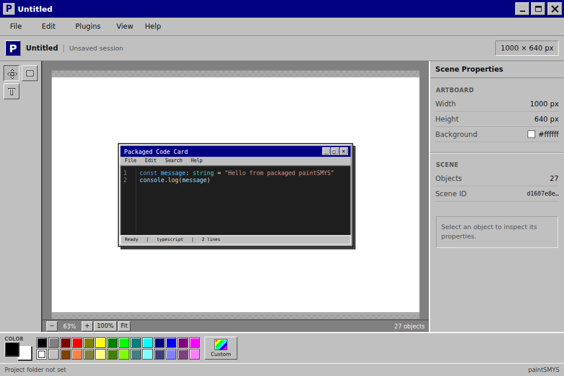

# paintSMYS

> Хотел повторить Microsoft Paint. Случайно начал делать векторный редактор с плагинами в стиле Windows 95.



## Что это?

paintSMYS — небольшой редактор для простых композиций. В Desktop-версии он работает как приложение Electron, а Web-версия открывается в браузере. Вместо одного растрового изображения на холсте лежат отдельные объекты: прямоугольники и текст.

Можно создать Artboard, нарисовать объекты, выбрать их, изменить цвет и свойства, сохранить проект в Desktop-версии и экспортировать результат в PNG. Локальные JavaScript-плагины добавляют команды и могут собирать композиции из тех же редактируемых объектов.

Это экспериментальный редактор, а не полноценная замена Microsoft Paint, Canva или Excalidraw.

## Быстрый старт

Готовых установщиков в [GitHub Releases](https://github.com/davy1ex/paintSMYS/releases) пока нет. Запусти приложение из исходников:

Требуется Node.js 22.12 или новее и npm 10 или новее. Проверенная среда этого аудита: Node.js 22.22.1, npm 11.20.0, Linux x64 под WSL2.

```bash
git clone https://github.com/davy1ex/paintSMYS.git
cd paintSMYS
npm ci
npm run dev:desktop
```

При первом запуске Desktop Electron автоматически загружает бинарный runtime для установленной версии; для этого нужен доступ к сети.

В стартовом окне нажми **New Project**, выбери размер Artboard или введи свой и нажми **Create**. Выбери **Rectangle** или **Text** на панели инструментов, затем нарисуй объект на белом Artboard. Выдели объект, чтобы поменять его свойства справа; цвет можно задать там же или выбрать в палитре внизу. Команды **Undo** и **Redo** находятся в меню **Edit**.

Чтобы запустить Web-версию, выполни `npm run dev:web` и открой адрес, напечатанный в терминале. В браузере можно создавать композиции в текущем сеансе, открывать папки проектов и скачивать PNG. Сохранение проекта в папку и локальные плагины пока доступны только в Desktop-версии.

## Что умеет редактор

- Artboard с готовыми размерами или произвольной шириной и высотой.
- Объекты Rectangle и Text: выбор, перемещение, удаление и редактирование свойств.
- Цветовая палитра, произвольный цвет заливки и обводки, свойства текста.
- Undo и Redo.
- Сохранение и открытие папки проекта в Desktop-версии. Данные сцены хранятся в `project.json`.
- Экспорт Artboard в PNG в Desktop и Web.
- Масштабирование и перемещение вида Artboard.

Кисти и свободного рисования, импорта изображений, полноценной системы слоёв и списка объектов пока нет.

## Плагины

Плагин — обычная папка с `manifest.json` и `index.js`. Он добавляет одну или несколько команд в меню **Plugins** и может создать на Artboard редактируемые объекты. Плагины работают в Desktop-версии; Web-версия их не загружает.

### Win95 Window

Команда **Generate Win95 Window** открывает форму для заголовка окна и приветствия, затем собирает окно в стиле Windows 95 из обычных Rectangle и Text. Элементы можно выбирать и менять по отдельности.

Плагин не требует сборки и готов к установке из каталога [`examples/plugins/win95-window`](examples/plugins/win95-window). Подробности — в его [README](examples/plugins/win95-window/README.md).

### Code Card

Команда **Generate Code Card** показывает форму для заголовка, языка и исходного кода. Плагин строит окно редактора кода и подсвечивает Python, JavaScript или TypeScript с помощью Shiki. Код остаётся текстовым объектом со стилями, а рамка и элементы окна — отдельными редактируемыми прямоугольниками.

Готовый самодостаточный `index.js` уже находится в [`examples/plugins/code-card`](examples/plugins/code-card); устанавливать зависимости для запуска плагина не нужно. Его можно пересобрать командой `npm run build:plugin:code-card`. Подробности и сторонние уведомления — в [README](examples/plugins/code-card/README.md) и [THIRD_PARTY_NOTICES.md](examples/plugins/code-card/THIRD_PARTY_NOTICES.md).

## Как установить плагин

1. Закрой paintSMYS.
2. Скопируй целую папку плагина в подкаталог `plugins` внутри Electron `userData`. При запуске из исходников текущий `userData` использует имя пакета `paint-smys`:

   | Система | Путь при запуске из исходников |
   | --- | --- |
   | Windows | `%APPDATA%\paint-smys\plugins\` |
   | Linux | `~/.config/paint-smys/plugins/` |
   | macOS | `~/Library/Application Support/paint-smys/plugins/` |

   Например, после копирования Code Card файл должен лежать по пути `.../plugins/code-card/manifest.json`, рядом с `index.js`. Если приложение собрано с другой конфигурацией имени, точный базовый путь задаёт `app.getPath('userData')`.

3. Запусти paintSMYS, открой или создай проект и выбери **Plugins → Generate Win95 Window** или **Plugins → Generate Code Card**.

После добавления, изменения или удаления плагина перезапусти приложение. Автоматической установки и горячей перезагрузки нет.

## Как написать свой плагин

Создай папку `hello-world` с двумя файлами. Это короткий пример API v0: команда добавляет обычный текстовый объект, без изменений в исходниках paintSMYS.

Для такого расположения текста выбери Artboard не меньше 480 × 160 px.

`manifest.json`:

```json
{
  "id": "com.example.hello-world",
  "name": "Hello World",
  "version": "1.0.0",
  "apiVersion": 0,
  "entry": "index.js",
  "commands": [
    { "id": "create-hello-world", "name": "Create Hello World" }
  ]
}
```

`index.js`:

```js
globalThis.paintSMYSPlugin = {
  activate(api) {
    api.registerCommand('create-hello-world', async (host) => {
      await host.addObjects([
        {
          type: 'text',
          x: 80,
          y: 100,
          text: 'Hello from a plugin!',
          fontFamily: 'Arial',
          fontSize: 32,
          color: '#000080',
        },
      ])
    })
  },
}
```

Скопируй папку `hello-world` в каталог `plugins` по инструкции выше, перезапусти Desktop-приложение и открой **Plugins → Create Hello World**. Контракт, ограничения объектов и формы описаны в [`docs/PLUGIN_API_V0.md`](docs/PLUGIN_API_V0.md).

## Разработка, сборка и тесты

Основные команды из `package.json`:

```bash
npm ci
npm run dev:desktop
npm run dev:web
npm run typecheck
npm test
npm run test:e2e
npm run test:e2e:desktop
npm run build
npm run package:dir
```

`npm run build` проверяет типы и собирает Desktop и Web. `npm run package:dir` создаёт распакованное приложение в `release/` для текущей платформы. В конфигурации также заданы цели NSIS для Windows, AppImage для Linux и DMG для macOS; проверялась только Linux x64 сборка в WSL2. Подпись приложений и проверка установщиков на Windows и macOS ещё не выполнены.

Для пересборки Code Card есть команда `npm run build:plugin:code-card`. Она создаёт готовый к копированию `examples/plugins/code-card/index.js` из исходника в `src/index.js`.

## Ограничения и безопасность

Plugin API v0 экспериментальный. Он предназначен для локальных плагинов, которым ты доверяешь. Код запускается в изолированном Worker и получает ограниченный API, но paintSMYS не обещает полной защиты от вредоносного JavaScript или уязвимостей Electron. Устанавливай только код, который готов запускать.

В Web-версии можно создавать объекты и экспортировать PNG, но нельзя сохранять проект на диск и запускать локальные плагины. В Desktop-версии доступны сохранение проектов и плагины.

В репозитории пока нет файла `LICENSE`, а `package.json` помечает проект как `UNLICENSED`. Публикация исходников на GitHub сама по себе не предоставляет автоматического разрешения на изменение и распространение кода; решение о лицензии остаётся за владельцем проекта.

## Ссылки

- GitHub: <https://github.com/davy1ex/paintSMYS>
- Telegram: <https://t.me/lowlvl_smys>
- [Plugin API v0](docs/PLUGIN_API_V0.md)
- [Changelog](CHANGELOG.md)
