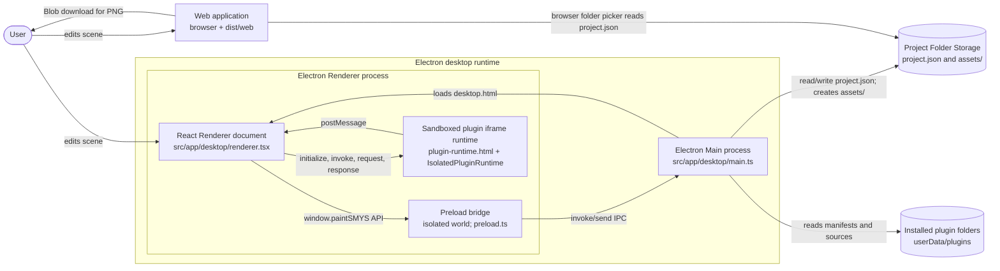
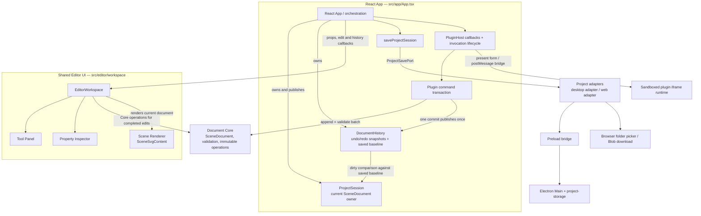

# paintSMYS — Architecture Map

**Status:** checked against the repository at `467f671` (2026-11-03). This describes implemented code, not the target design in [ARCHITECTURE.md](ARCHITECTURE.md) or every requirement in [PRD.md](PRD.md). Source paths below are the evidence for the boxes and arrows.

## C4 container view



**Container semantics:** Electron Main and Renderer are separate processes. The Web application is a separate browser deployment built from the same React app. Preload is an isolated-world script in the Renderer, not another process. The plugin iframe is a sandboxed JavaScript realm inside the Renderer, not a separately deployed application or a promised OS process. The project folder is a data store, not a software container. These distinctions match `src/app/desktop/main.ts`, `src/app/desktop/preload.ts`, `src/app/desktop/plugins/isolated-plugin-runtime.ts`, `src/app/web/main.tsx`, and `src/app/desktop/project-storage.ts`.

Desktop project open/save/export and plugin catalog calls cross the typed `window.paintSMYS` bridge in [preload.ts](../src/app/desktop/preload.ts). Main handles them in [main.ts](../src/app/desktop/main.ts); project manifests are read and written by [project-storage.ts](../src/app/desktop/project-storage.ts). The Web adapter in [project-adapter.ts](../src/app/web/project-adapter.ts) can open a folder where browser APIs allow it and download PNGs, but it has no project-save operation. `assets/` is created on Desktop save, but an asset import/store flow is not implemented.

## C4 component view — editor



Evidence: [App.tsx](../src/app/App.tsx) stores `session` and `sessionRef`, owns `historyRef`, wires adapters, save and plugin callbacks; [project-session.ts](../src/application/project-session.ts) defines immutable session updates; [document-history.ts](../src/application/document-history.ts) stores history snapshots and the saved baseline. [EditorWorkspace.tsx](../src/editor/workspace/EditorWorkspace.tsx) owns transient tool, selection, pointer gesture and text-draft state, calls Core operations for completed edits, and sends document changes to App. [ToolPanel.tsx](../src/editor/workspace/ToolPanel.tsx) selects a tool, [PropertyInspector.tsx](../src/editor/workspace/PropertyInspector.tsx) commits editable properties, and [SceneSvgContent.tsx](../src/editor/workspace/SceneSvgContent.tsx) renders the artboard and scene objects.

Core is [scene-document.ts](../src/core/document/scene-document.ts) plus [project-manifest.ts](../src/core/project/project-manifest.ts). It validates scene values and returns new document snapshots. `ProjectSession.document` held by App is the current scene source of truth; history keeps prior snapshots and a saved-baseline reference, while EditorWorkspace keeps only transient UI state. Application save coordination is in [save-project-session.ts](../src/application/save-project-session.ts); the platform ports are in `src/application/*-port.ts`; adapters are [desktop](../src/app/desktop/project-adapter.ts) and [web](../src/app/web/project-adapter.ts).

### Observed boundary notes

- The source import graph is directional from app/UI and adapters toward Application/Core; no import cycle was found. Core has no React, Electron, DOM or filesystem imports.
- Shared `App.tsx` directly reads `window.paintSMYS?.windowControls` for the Desktop close handshake, although the target architecture says common UI should not reach a Desktop global. This is a real platform coupling to keep visible; it is not refactored in this audit. The Web branch also installs `beforeunload` protection.
- `EditorWorkspace` uses the DOM/SVG for pointer and keyboard input, but has no Electron import. Desktop filesystem access stays behind the adapter → preload → Main path.
- `src/app/desktop/plugins/isolated-plugin-runtime.ts` is a renderer-side host despite its `desktop` path: it creates the sandboxed iframe and coordinates plugin messages; the app layer owns the transaction and session guard.
- The PRD describes broader project, asset and web-viewer goals. In the checked implementation, Web Save Project and the separate Web Viewer are absent; PNG export is implemented in both platforms. Desktop plugin loading is local and is not available in the Web entrypoint.

## Execution flow A — Rectangle → Undo → Save (Desktop)

`EditorWorkspace.finishGesture` converts the SVG pointer coordinates, calls Core `addRectangle`, then sends the before/after documents through `onDocumentChange`. App checks the project ID and source-document identity, records one history entry, and calls `updateProjectSessionDocument` with `history.isDirty(...)`. Ctrl+Z calls `navigateDocumentHistory`, which restores the previous snapshot and recalculates dirty state. A newly created untitled project has no saved baseline, so after Undo it is still dirty. File → Save therefore becomes Save As, writes the empty post-Undo scene, then marks that exact snapshot as saved.

```mermaid
sequenceDiagram
  actor User
  participant UI as EditorWorkspace
  participant Core as Document Core
  participant App as App / ProjectSession
  participant History as DocumentHistory
  participant UseCase as saveProjectSession
  participant Adapter as Desktop project adapter
  participant Bridge as Preload bridge
  participant Main as Electron Main
  participant Disk as Project Folder Storage

  User->>UI: drag on SVG (pointerdown/move/up)
  UI->>Core: addRectangle(document, geometry)
  Core-->>UI: new immutable SceneDocument
  UI->>App: onDocumentChange(previous, next)
  App->>History: recordChange(previous, next)
  App->>App: updateProjectSessionDocument(next, history.isDirty(next))
  User->>UI: Ctrl+Z
  UI->>App: onUndo()
  App->>History: undo(current document)
  History-->>App: previous (empty) document
  App->>History: isDirty(previous)
  App->>App: update ProjectSession; still dirty (no baseline yet)
  User->>UI: File > Save
  UI->>App: handleSave('save')
  App->>UseCase: saveProjectSession(snapshot, adapter)
  UseCase->>Adapter: saveProject(request, mode='save-as')
  Adapter->>Bridge: window.paintSMYS.saveProject(request)
  Bridge->>Main: invoke('paintSMYS:save-project', request)
  Main->>Main: native Save Dialog + target validation
  Main->>Disk: saveProjectAsFolder() / atomic project.json write
  Disk-->>Main: projectRoot + projectName
  Main-->>Bridge: saved result
  Bridge-->>Adapter: saved result
  Adapter-->>UseCase: saved result
  UseCase-->>App: saved snapshot
  App->>App: mergeSavedProjectSession + history.markSaved(snapshot.document)
  App->>App: recompute dirty against saved baseline
```

Key functions: `finishGesture` / `handlePointerDown` and `handleShortcut` in `EditorWorkspace.tsx`; `updateDocument`, `publishDocumentChange`, `navigateDocumentHistory`, and `save` in `App.tsx`; `recordChange`, `undo`, `isDirty`, `markSaved` in `document-history.ts`; `saveProjectSession` / `mergeSavedProjectSession`; preload `saveProject`; Main's `paintSMYS:save-project` handler; `saveProjectAsFolder` / `writeManifestAtomically` in `project-storage.ts`. A concurrent edit during the async write remains current and dirty; the saved baseline is the snapshot sent to Main.

## Execution flow B — External Plugin → Form → Document

The Desktop runtime loads a local plugin catalog, validates manifests and starts each plugin in a sandboxed iframe. The iframe creates a Worker for plugin source. The bridge checks message source/origin and invocation/request IDs; the host validates the form schema and submitted values. Object batches are staged in `createPluginCommandTransaction` and Core `appendSceneObjects` validates each staged addition. Only a successful `finished` message commits once; App verifies the same session generation, history object and source document before publishing one undoable change.

```mermaid
sequenceDiagram
  actor User
  participant Menu as Plugins Menu
  participant App as App / PluginHost
  participant Runtime as IsolatedPluginRuntime
  participant IFrame as Sandboxed iframe bridge
  participant Worker as Plugin Worker
  participant Dialog as PluginFormDialog
  participant Tx as Plugin command transaction
  participant Core as Document Core
  participant History as DocumentHistory

  User->>Menu: choose external command
  Menu->>App: onPluginCommand(command)
  App->>Runtime: invoke(pluginId, commandId, sessionGeneration)
  Runtime->>App: beginCommand(sessionGeneration)
  App->>Tx: create transaction from current document
  Runtime->>IFrame: postMessage(invoke, invocationId)
  IFrame->>Worker: invoke plugin command
  Worker->>IFrame: host.ui.showForm(schema)
  IFrame->>Runtime: postMessage(request: show-form)
  Runtime->>App: presentForm(validated schema, requestId)
  App->>Dialog: render React form
  User->>Dialog: submit field values
  Dialog->>App: onSubmit(requestId, values)
  App->>Runtime: submitForm(requestId, values)
  Runtime->>Runtime: validate values, check current session
  Runtime->>IFrame: postMessage(response: submitted values)
  IFrame->>Worker: resolve showForm() promise
  Worker->>IFrame: host.document.addObjects(batch)
  IFrame->>Runtime: postMessage(request: add-objects)
  Runtime->>Tx: addObjects(batch)
  Tx->>Core: appendSceneObjects(staged document, batch)
  Core-->>Tx: validated staged document
  Worker->>Runtime: finished(success)
  Runtime->>Tx: commit()
  Tx->>App: onCommit(staged document)
  App->>App: verify generation + history + source document
  App->>History: recordChange(source, committed document)
  App-->>User: one undoable edit; normal Undo/Redo
```

Failure behavior is implemented, not inferred: schema/value/batch validation errors reject the bridge request; a plugin error, load timeout (8 s), command timeout (60 s), form timeout (5 min), frame destruction or explicit Cancel finishes the invocation without commit and rolls back staged objects. The command execution timeout pauses while the form is open. App increments the session generation on session replacement; the runtime checks it on each request and form submission, and the commit callback checks generation, history identity and source-document identity again. See [isolated-plugin-runtime.ts](../src/app/desktop/plugins/isolated-plugin-runtime.ts), [plugin-runtime.html](../src/app/desktop/plugins/runtime-assets/plugin-runtime.html), [PluginFormDialog.tsx](../src/app/PluginFormDialog.tsx), [plugin-command-transaction.ts](../src/application/plugins/plugin-command-transaction.ts), and plugin callbacks in [App.tsx](../src/app/App.tsx).
